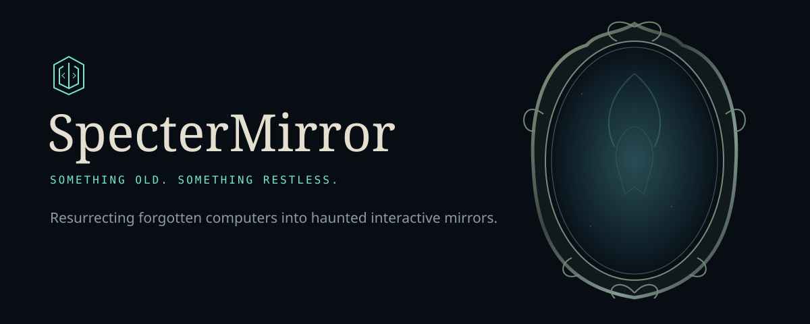

# SpecterMirror



Resurrecting forgotten computers into haunted interactive mirrors.

SpecterMirror is a CPU-only haunted mirror for older Linux laptops, with a
shared Rust engine and a browser interface. The native target is 32-bit antiX
with X11. Browser processing runs locally through WebAssembly and Canvas.

## Foundation

The browser supports Mirror, Spectral Mirror and Cursed Portrait, using shared
Rust grayscale, Sobel and Bayer processing. Combine any palette with delayed
reflection and ghost trails, or choose a named combination. Choose a webcam
or an original generated visitor scene, then use Full screen for an immersive
view. Camera access requires a button click; frames stay on your device.
Automatic haunting opens as a clear mirror, then uses a seeded director to
select delay, trails and short skull events after motion. Palette strength
follows the shared progression. Skull events require fresh head bounds;
reduced motion suppresses temporal effects and skulls. Turn automatic haunting
off to use the manual controls.
The native X11 application animates a generated diagnostic sample through
the same delay/trail engine, with a 160 x 120 fallback. Opt-in
`--camera /dev/videoN` feeds V4L2 RGB24 or YUYV frames through that pipeline
and falls back once to the sample if the camera is missing, unsupported,
disconnected or stalled. It is unverified on physical hardware, so treat it as
a development path. Default native capture uses manual delay/trails; automatic
face-triggered haunting is opt-in. Branding illustrations are illustrative.

The opt-in native [idle artwork mode](docs/IDLE_ARTWORK.md) displays three bundled
public-domain works in their original colors, shuffled after roughly 2 minutes.
With an explicit camera, sustained face detection
for more than 2 seconds reveals the haunted live mirror; 3 seconds without a
face returns to a green photo that slowly recovers its original colors.
Native face detection and haunting remain unverified
on the target laptops.

```bash
./dev --help
rustup toolchain install 1.99.1 --profile minimal --component rustfmt,clippy --target i686-unknown-linux-gnu,wasm32-unknown-unknown
./dev test
./dev all-test
./dev native-proof
./dev preview --camera          # development webcam preview; requires ffmpeg and X11
./check
cd web
npm ci
cargo install wasm-pack --version 0.15.1 --locked
npm run build
```

Ubuntu native builds need `build-essential`, `pkg-config` and `libx11-dev`.
The V4L2 bindings are generated at build time, so they also need libclang and
the kernel headers (`linux-libc-dev`). Full i686 checks also need
`gcc-multilib` and `libc6-dev-i386`.
The X11 proof needs a display; use `xvfb-run -a ./dev native-proof` in CI.

## Try locally

Run `./demo native` to keep the animated native sample open until Escape.
Use the native executable's `--help` for delay, trails, resolution and reduced
motion controls; [native options](docs/NATIVE_COMPATIBILITY.md) include examples.
Opt-in `--metrics` and `--run-for-ms N` print bounded timing and counter
reports; `scripts/native_validation.py` runs them locally. See
[native validation](docs/NATIVE_VALIDATION.md). No target measurement exists yet.
Run `./demo web` to preview the interface at
http://127.0.0.1:5173/specter-mirror/. Use `./demo web --port 5179` if the
default port is occupied. Install web dependencies with `npm ci --prefix web`
and wasm-pack with the command above. The helper builds WASM before serving.

`./demo vm` forwards the verified ISO and guest options to the
[QEMU runner](vm/README.md). It creates a disposable virtual disk and does not
provision the development workstation. Run `./demo --help` for complete examples.

## Documentation

- [Architecture](docs/ARCHITECTURE.md) and [effects](docs/EFFECTS.md).
- [i686 build](docs/BUILD_I686.md), [antiX installation](docs/INSTALL_ANTIX.md), [hardware](docs/HARDWARE.md).
- [WASM build](docs/BUILD_WASM.md), [web interface](docs/WEB_DEMO.md), [privacy](docs/PRIVACY.md).
- [Native validation](docs/NATIVE_VALIDATION.md), [virtual machines](vm/README.md), [ISO media](docs/ISO.md), [benchmarks](docs/BENCHMARKS.md), [demo verification](docs/DEMO.md).
- [Kiro development](docs/KIRO-DEVELOPMENT.md), [contributing](CONTRIBUTING.md), [security](SECURITY.md).
- [Asset provenance](assets/PROVENANCE.md).
- [Reused components and licenses](docs/DEPENDENCIES.md).

The browser demo is https://nikolareljin.github.io/specter-mirror/.
The Pages workflow publishes verified builds from `main`. The web source includes a matching
About page with links to selected public projects.

## Next steps

Connect the native laptop camera and add more effects, then extend the engine
into a modular Smart Mirror. Halloween is the first filter theme.
Live processing and physical hardware verification must precede release claims.

Original source and SVG artwork use [Apache-2.0](LICENSE). Third-party notices
and dependency licenses remain applicable. The bundled museum paintings use
CC0; see [asset provenance](assets/PROVENANCE.md).
